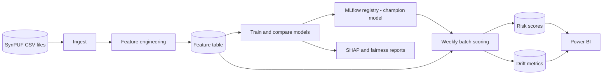

# CareRisk: Predicting 30-Day Hospital Readmissions

CareRisk is my minor specialization project. It predicts which Medicare patients are likely to be readmitted within 30 days of a hospital discharge. I built it end to end in PySpark on Databricks, using the synthetic Medicare claims that CMS publishes (DE-SynPUF).

It covers the whole lifecycle:
- turning raw claims into patient-level features
- comparing three models without letting future data leak into training
- tracking experiments and the final model in MLflow
- explaining each prediction with SHAP
- checking the model for fairness across age and sex
- scoring new discharges every week, checking for data drift, and sending the results to a Power BI dashboard

## Why this problem

Readmissions within 30 days are expensive and often avoidable, and Medicare penalises hospitals that have too many of them. A care team can't follow up with every discharged patient, so the useful question is: *who should we call first, and why?* CareRisk answers that by giving every discharge a risk score, putting it into a High, Medium or Low tier, and listing the main factors behind the score.

## How it works



There are four steps. Each one is a Databricks notebook task, and you can also run each one locally from the command line.

1. **Ingest.** Reads the beneficiary, inpatient and outpatient files and cleans them up. One detail turned out to matter: a patient moved between hospitals on the same day shows up as two claims. I merge overlapping and same-day claims into a single hospital stay, so transfers don't get counted as readmissions.
2. **Features.** Builds one row per hospital stay with its readmission label and the features described below.
3. **Train.** Compares logistic regression, random forest and XGBoost, logs everything to MLflow, and registers the best model. It also produces the SHAP and fairness reports.
4. **Score.** A scheduled job loads the registered model, scores recent discharges, attaches the top three reasons to each score, and checks whether incoming data has drifted from the training data.

## Building the dataset

**Which stays count.** Every hospital stay starting in 2009 or later is a prediction point. I keep 2008 as history only, so every stay has a full year of look-back.

**The label.** A stay is labelled as a readmission if the patient's next admission starts within 1 to 30 days of discharge.

**Exclusions.** I drop stays where the patient:
- died in hospital
- died within 30 days without being readmitted, since we can't know whether they would have been
- was discharged too close to the end of the data to have 30 days of follow-up

**Features.** There are 35 in total, grouped like this:

| Group | What's included |
|---|---|
| Demographics | age, sex, race, end-stage renal disease |
| The current stay | length of stay, number of diagnoses and procedures, payment amount |
| Past hospital use | admissions in the last 6 and 12 months, inpatient days in the last year, days since the last discharge, outpatient visits in the last 30 days and 12 months |
| How sick the patient is | Charlson Comorbidity Index from ICD-9 diagnosis codes, its main components (heart failure, COPD, kidney disease, cancer and so on), and 11 chronic-condition flags from CMS |
| Past cost | the patient's inpatient, outpatient and physician costs from the previous year |

Every feature uses only information that would have been available on the day of discharge. For example, the chronic-condition flags and costs come from the previous year's file. The current year's file would include things that hadn't happened yet.

## Keeping the evaluation honest

The easiest way to get impressive but meaningless results here is to let the same patient appear in both training and test data, or to train on data from after the test period. To avoid both:
- each patient is randomly assigned to exactly one group: train (70%), validation (15%) or test (15%)
- train and validation use 2009 stays
- test uses only 2010 stays, from patients the model has never seen

So the test set checks what happens in deployment: new patients, at a later date. The training code also stops with an error if any patient ends up in two groups.

Model selection works like this:
- each model setting is trained on the training set and compared on the validation set
- the best setting for each model type is scored once on the test set
- the confidence intervals come from resampling patients rather than individual stays, because one patient can have several stays
- the model type with the best validation AUPRC becomes the champion and is registered in MLflow

I focus on AUPRC alongside AUROC because readmissions are the minority class, and AUPRC is more sensitive to how well the model ranks the patients that matter.

For the risk tiers, High means the top 10% of scores and Medium the top 30%, with thresholds set on the validation set. The idea is that a care team has a fixed capacity, so the tiers match how many patients they can actually reach.

## Results

These numbers come from the sample-data generator included in the repo (see below), which I used to test the pipeline end to end. They are not results on the real CMS data. Run the pipeline on the actual SynPUF files to get those.

| Model | Test AUROC (95% CI) | Test AUPRC (95% CI) | AUPRC gain over baseline |
|---|---|---|---|
| XGBoost (champion) | 0.786 (0.745 to 0.820) | 0.611 (0.517 to 0.689) | +0.009 |
| Random forest | 0.784 (0.742 to 0.819) | 0.610 (0.512 to 0.688) | +0.008 |
| Logistic regression (baseline) | 0.778 (0.734 to 0.815) | 0.602 (0.502 to 0.680) | n/a |

To be upfront: on this data the tree models are only slightly better than logistic regression, and the difference isn't statistically significant. The tiers still separate patients well. In the scored batch, 74% of High-tier patients were actually readmitted, compared with 48% of Medium and 17% of Low.


**What drives the predictions.** The SHAP summary below shows that past hospital use dominates: inpatient days in the last year, prior inpatient cost, outpatient visits and how recently the patient was discharged. That matches what the clinical literature reports.


Each scored patient also gets their own explanation. For example, a High-tier patient might look like this:

```
risk score 0.81 (High)
  prior inpatient days in last year = 115    (+0.69)
  prior-year inpatient cost (log)  = 12.57  (+0.52)
  outpatient visits in last year   = 63     (+0.19)
```

**Fairness.** I compared performance across age bands and between men and women. For each group I checked:
- how well the model ranks patients (AUROC)
- how many of the people who were readmitted it catches (true positive rate)
- whether predicted risk matches the observed rate

The audit flags any group that falls well behind the best-performing group. On the sample data, it flagged the 85+ group and women, mostly because fewer of their readmissions were caught at the High threshold. I'd want to dig into that before using a model like this for real.


## Monitoring for drift

Every scoring run compares the new batch with the training data using the Population Stability Index (PSI). It does this for each feature and for the model's score.

| PSI | Meaning |
|---|---|
| Below 0.10 | Stable |
| 0.10 to 0.25 | Worth a look |
| 0.25 and above | Significant shift, probably time to retrain |

The results are appended to a table on every run, so the dashboard can show drift over time. You can also set the job to fail on a significant shift.

## Running it locally

You'll need:
- Python 3.11
- Java 17 or 21 (for Spark)
- [uv](https://github.com/astral-sh/uv)
- on a Mac, `brew install libomp` (XGBoost needs it)

```bash
git clone https://github.com/420abhijeet420/carerisk.git
cd carerisk
make setup     # creates a virtual environment and installs dependencies
make sample    # generates sample data in the SynPUF file format
make all       # runs ingest, features, train and score
make test      # runs the unit tests
make mlflow    # opens the MLflow UI at http://localhost:5000
```

To use the real CMS data instead of the sample (Sample 1 is about 120 MB to download):

```bash
make clean && make data && make all
```

Charts, tables and CSV exports for Power BI end up in the `reports/` folder.

**About the sample data.** The real SynPUF files are large. While developing, I wanted something quick that exercises every step, so `scripts/make_sample_data.py` generates data with the exact same file names and columns. It builds in a known readmission pattern and a deliberate shift in 2010, so the drift check has something to find. It's only for testing the pipeline.

## Running it on Databricks

The same code runs on Databricks without changes. It detects the environment and switches from local Parquet files and a local MLflow database to Delta tables and the Unity Catalog model registry.

1. Create a schema and a volume in Unity Catalog, for example `main.carerisk` and `/Volumes/main/carerisk/raw`, and upload the SynPUF CSV files to the volume.
2. Deploy the jobs and run training:
   ```bash
   databricks bundle deploy -t dev
   databricks bundle run carerisk_training
   ```
3. The scoring job then runs every Monday at 06:00 UTC.
4. Point Power BI at the `gold_risk_scores` and `gold_drift_metrics` tables. [powerbi/POWERBI.md](powerbi/POWERBI.md) explains how to connect, which measures to create and how I laid out the dashboard pages.

If you're on the Databricks Free Edition, remove the cluster settings from `resources/jobs.yml` so the jobs run on serverless compute.

## Project layout

```
carerisk/
├── conf/config.yaml        settings: dates, split sizes, tier cut-offs, drift thresholds
├── src/carerisk/
│   ├── ingest.py           reads and cleans the claims, merges transfers
│   ├── comorbidity.py      Charlson Comorbidity Index from ICD-9 codes
│   ├── features.py         cohort, label, features and the train/val/test split
│   ├── train.py            model comparison, confidence intervals, MLflow registration
│   ├── explain.py          SHAP values and per-patient reasons
│   ├── fairness.py         performance by age band and sex
│   ├── score.py            weekly batch scoring
│   ├── drift.py            Population Stability Index
│   ├── tracking.py         MLflow setup for local and Databricks
│   └── pipeline.py         command-line entry point
├── notebooks/              one Databricks notebook per pipeline step
├── resources/jobs.yml      training job and the scheduled scoring job
├── databricks.yml          Databricks Asset Bundle config
├── powerbi/POWERBI.md      dashboard guide
├── scripts/                CMS download script and sample data generator
├── tests/                  unit tests
└── Makefile
```

## Limitations

- **The data is synthetic.** To protect privacy, CMS altered the variables in SynPUF independently of each other, which weakens the real relationships between them. Models trained on it will score lower than they would on real claims. This project is about the methods and engineering, not a clinical tool.
- **Planned readmissions are counted.** I don't exclude planned readmissions, such as scheduled chemotherapy, the way the official CMS measure does.
- **No discharge disposition.** SynPUF doesn't record where patients went after discharge, which would likely be a strong predictor.
- **Fairness is measured, not corrected.** The audit flags groups that need attention but doesn't change the model.

## References

- CMS, [Medicare Claims Synthetic Public Use Files (DE-SynPUF)](https://www.cms.gov/data-research/statistics-trends-and-reports/medicare-claims-synthetic-public-use-files)
- CMS, [Hospital Readmissions Reduction Program](https://www.cms.gov/medicare/payment/prospective-payment-systems/acute-inpatient-pps/hospital-readmissions-reduction-program-hrrp)
- Quan H. et al. (2005). Coding algorithms for defining comorbidities in ICD-9-CM and ICD-10 administrative data. *Medical Care*, 43(11).
- Lundberg S. and Lee S. (2017). A unified approach to interpreting model predictions. *NeurIPS*.

---

Built by [420abhijeet420](https://github.com/420abhijeet420) as a minor specialization project.
